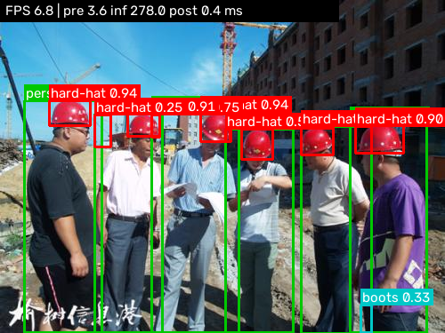

# ppe-edge-runner-cpp

A C++17 edge-inference runner for two YOLOv8n ONNX models (person detector, PPE detector). It reads images, a video file or a
webcam, runs the models on the CPU with ONNX Runtime, draws the detections with an FPS read-out, and has a headless benchmark
mode that times every pipeline stage. A small Python reference runs the same models with the same preprocessing and
thresholds, and a test checks that the two produce the same boxes.

Pipeline per frame: **acquire -> preprocess (letterbox, HWC uint8 to CHW float) -> inference -> postprocess (decode, NMS) -> draw**.
Two-stage cascade (`--cascade`): the person model runs on the whole frame, each person box is cropped, and the PPE model runs on every crop.
Single-model mode runs the person model (or the PPE model with `--ppe` only) on the whole frame.

This is a laptop project (Apple M4, CPU only, no edge board). Numbers below are laptop CPU numbers, not edge-device numbers.



*`ppe_runner --variant fp32 --cascade` on one of the 40 test images; the FPS read-out in the corner is what the program measured for that frame.*

## Layout

| path | what |
|---|---|
| `src/yolo.{hpp,cpp}` | letterbox, CHW packing, YOLOv8 decode, class-aware NMS (no ONNX Runtime dependency, unit-tested) |
| `src/detector.{hpp,cpp}` | one ONNX Runtime session; checks the output shape is `(1, 4+nc, 8400)`; times pre / inference / post |
| `src/pipeline.{hpp,cpp}` | single-model and person -> crop -> PPE cascade |
| `src/main.cpp` | CLI: live UI, `--bench`, `--dump` |
| `python/ref.py` | independent Python reference (numpy + OpenCV `dnn.NMSBoxesBatched`), same flags, same JSON schema |
| `python/compare.py` | box-by-box comparison, writes `results/correctness_*.json` |
| `tests/` | `unit_tests.cpp` (letterbox, tensor packing, NMS, decode) and `run_correctness.sh` (C++ vs Python) |
| `scripts/run_benchmarks.sh`, `scripts/render_readme.py` | run all benchmarks; render the tables below from `results/` |
| `models/`, `data/person_test/` | the four ONNX models and the 40 test images (provenance below) |

## Requirements (what this was built and tested with)

macOS on Apple silicon, Homebrew. Both libraries ship CMake config files, so `find_package` is enough; the configure step prints the exact paths it found:

```
-- Found OpenCV: /opt/homebrew/Cellar/opencv/5.1.0 (found version "5.1.0")
-- OpenCV 5.1.0 (/opt/homebrew/opt/opencv/lib/cmake/opencv5)
-- ONNX Runtime 1.32.0 (/opt/homebrew/opt/onnxruntime/lib/cmake/onnxruntime)
```

```sh
brew install cmake opencv onnxruntime   # cmake 4.5.0, opencv 5.1.0, onnxruntime 1.32.0 were installed
brew install uv                         # only for the Python reference / tests
```

Compiler: Apple clang 21.0.0 (C++17). `CMakeLists.txt` defaults to a Release build, which the timings need.

## Build and test

```sh
cmake -S . -B build && cmake --build build

uv venv -p 3.12 .venv                                        # Python reference environment
uv pip install --python .venv/bin/python -r python/requirements.txt

ctest --test-dir build --output-on-failure                   # unit tests + C++ vs Python box agreement
```

Optional second build, linked against the ONNX Runtime that sits inside the Python wheel instead of Homebrew's (same version, 1.32.0;
see "Why Homebrew's ONNX Runtime is slower" below for why that matters). The benchmark script uses both:

```sh
cmake -S . -B build-wheelort -DORT_LIBRARY=$PWD/.venv/lib/python3.12/site-packages/onnxruntime/capi/libonnxruntime.1.32.0.dylib
cmake --build build-wheelort
```

The link step prints `building for macOS-27.0, but linking with dylib ... built for newer version` warnings; they come from the
Homebrew libraries' deployment target and are harmless here.

## Run

```sh
# live window over the test images (q or Esc quits)
./build/ppe_runner --variant fp32 --cascade --source data/person_test

# a video file, or a webcam index
./build/ppe_runner --variant int8 --cascade --source data/sample_video.mp4
./build/ppe_runner --variant fp32 --cascade --source 0

# no window; save the rendered 9th frame (index 8) as an image
./build/ppe_runner --variant fp32 --cascade --no-display --source data/person_test --save-frame docs/screenshot.png --save-index 8 --max-frames 9

# single model: person only (default) or PPE only on whole images
./build/ppe_runner --variant fp32 --source data/person_test --no-display --max-frames 5
./build/ppe_runner --ppe models/ppe_fp32.onnx --source data/person_test --no-display --max-frames 5

# headless benchmark: median and p95 per stage -> JSON
./build/ppe_runner --variant int8 --cascade --bench --threads 1 --out results/example_bench.json

# detections of all 40 images -> JSON
./build/ppe_runner --variant fp32 --cascade --dump results/dets.json
```

`--variant fp32|int8` selects `models/{person,ppe}_<variant>.onnx`; `--person FILE` and `--ppe FILE` give explicit paths.
`--threads N` sets ONNX Runtime intra-op threads (0 = its default). `ppe_runner --help` lists everything.
The FPS in the window is 1 / (read + preprocess + inference + postprocess), smoothed over frames; drawing and window time are excluded.

To redo all measurements and refresh the tables below:

```sh
scripts/run_benchmarks.sh 3                      # 3 interleaved rounds, C++ (both builds) and Python, writes results/bench/*.json
scripts/diag_ort_build.sh                        # fp32 Homebrew-vs-wheel ONNX Runtime diagnostic -> results/ort_build_diag.json
tests/run_correctness.sh                         # writes results/correctness_*.json (also run by ctest)
.venv/bin/python scripts/render_readme.py        # rewrites the results block of this README
```

## Results

All numbers are generated from the JSON files in `results/` by `scripts/render_readme.py`.

<!-- RESULTS:BEGIN (generated by scripts/render_readme.py; do not edit by hand) -->
Each run: 40 images x 3 timed passes (+1 warmup) = 120 timings per run, repeated in 3 interleaved rounds (the three implementations back to back); every cell is the median over
rounds of that round's median (p95 = median over rounds of that round's 95th percentile). Times are milliseconds per image on the 40 held-out person test images; image decoding is not timed.
In cascade mode a stage is summed over the person run and every PPE crop of that image.

- C++: OpenCV 5.1.0, Apple LLVM 21.0.0 (clang-2100.3.34.2), Release build; ONNX Runtime 1.32.0 from Homebrew (`/opt/homebrew/Cellar/onnxruntime/1.32.0/lib/libonnxruntime.1.32.0.dylib`), and a second build of the same code linked against the ONNX Runtime 1.32.0 inside the Python wheel (`.venv/.../onnxruntime/capi/`)
- Python reference: ONNX Runtime 1.32.0 (pip wheel), opencv-python 5.0.0, numpy 2.5.5, Python 3.12.15
- CPU: Apple M4; execution provider: CPU only; thresholds conf 0.25, NMS IoU 0.45
- Letterboxed pixels, C++ (OpenCV 5.1.0) vs Python (opencv-python 5.0.0): 34/40 images differ, max |difference| 1 grey level, 10.9% of values differ on average (results/resize_diff.json)
- Machine load while benchmarking (1-minute load average, 10 cores, other jobs were running): 4.4 to 10.3

### Headlines

- Cascade, fp32, default threads, total per image: C++ pip-wheel ORT 76.1 ms, Python 77.7 ms, C++ Homebrew ORT 134.2 ms.
- Cascade, int8, default threads, total per image: C++ pip-wheel ORT 60.6 ms, Python 59.3 ms, C++ Homebrew ORT 66.1 ms.
- Preprocess + postprocess only, sum of the two medians (cascade, fp32, default threads): C++ 1.38 ms, Python 4.12 ms (3.0x). Inference is 98% of the C++ total, so the language only changes the small part.
- int8 vs fp32 in C++ (Homebrew ORT, cascade, default threads): 2.03x faster; with the pip-wheel ORT: 1.26x (1 thread: 0.67x, i.e. int8 is slower there).
- Box agreement C++ vs Python, fp32, persons + PPE items together: 437/439 = 99.54% with identical network input; 422/440 = 95.91% with each side's own OpenCV resize.
- Box agreement C++ vs Python, int8, persons + PPE items together: 409/409 = 100.00% with identical network input; 348/410 = 84.88% with each side's own OpenCV resize.

### Latency, cascade, 1 thread (`--threads 1`)

| variant | stage | C++ (Homebrew ORT) median (p95) | C++ (pip-wheel ORT) median (p95) | Python (pip-wheel ORT) median (p95) | Python / C++ pip-wheel ORT | Python / C++ Homebrew ORT |
|---|---|---|---|---|---|---|
| fp32 | preprocess | 0.82 (2.68) | 0.85 (2.88) | 1.87 (6.45) | 2.21x | 2.28x |
| fp32 | inference | 317.70 (1065.20) | 68.44 (247.62) | 70.47 (241.21) | 1.03x | 0.22x |
| fp32 | postprocess | 0.12 (0.47) | 0.12 (0.46) | 0.62 (2.31) | 5.38x | 5.39x |
| fp32 | total (incl. crops) | 318.79 (1069.48) | 69.46 (251.08) | 72.85 (250.99) | 1.05x | 0.23x |
| int8 | preprocess | 0.81 (2.81) | 0.81 (2.78) | 1.81 (6.50) | 2.23x | 2.23x |
| int8 | inference | 108.68 (371.79) | 102.96 (374.08) | 103.54 (353.46) | 1.01x | 0.95x |
| int8 | postprocess | 0.11 (0.44) | 0.11 (0.45) | 0.58 (2.08) | 5.40x | 5.22x |
| int8 | total (incl. crops) | 110.34 (375.40) | 103.81 (377.49) | 105.88 (361.86) | 1.02x | 0.96x |

### Latency, cascade, ONNX Runtime default threads (`--threads 0`)

| variant | stage | C++ (Homebrew ORT) median (p95) | C++ (pip-wheel ORT) median (p95) | Python (pip-wheel ORT) median (p95) | Python / C++ pip-wheel ORT | Python / C++ Homebrew ORT |
|---|---|---|---|---|---|---|
| fp32 | preprocess | 1.23 (3.93) | 1.23 (3.55) | 3.23 (9.74) | 2.62x | 2.63x |
| fp32 | inference | 132.83 (451.98) | 74.86 (238.01) | 73.81 (244.02) | 0.99x | 0.56x |
| fp32 | postprocess | 0.16 (0.62) | 0.15 (0.59) | 0.89 (3.10) | 5.98x | 5.69x |
| fp32 | total (incl. crops) | 134.20 (456.39) | 76.15 (241.91) | 77.75 (258.46) | 1.02x | 0.58x |
| int8 | preprocess | 1.19 (3.57) | 1.12 (3.47) | 2.89 (8.53) | 2.59x | 2.42x |
| int8 | inference | 64.50 (205.27) | 59.41 (185.14) | 55.86 (182.75) | 0.94x | 0.87x |
| int8 | postprocess | 0.12 (0.53) | 0.13 (0.54) | 0.74 (2.76) | 5.52x | 5.94x |
| int8 | total (incl. crops) | 66.08 (208.92) | 60.59 (190.91) | 59.30 (195.60) | 0.98x | 0.90x |

### Latency, person model only, default threads

| variant | stage | C++ (Homebrew ORT) median (p95) | C++ (pip-wheel ORT) median (p95) | Python (pip-wheel ORT) median (p95) | Python / C++ pip-wheel ORT | Python / C++ Homebrew ORT |
|---|---|---|---|---|---|---|
| fp32 | preprocess | 0.34 (0.62) | 0.33 (0.58) | 0.82 (1.66) | 2.49x | 2.41x |
| fp32 | inference | 39.50 (47.98) | 20.66 (28.99) | 21.50 (32.62) | 1.04x | 0.54x |
| fp32 | postprocess | 0.01 (0.02) | 0.01 (0.02) | 0.17 (0.34) | 13.64x | 13.23x |
| fp32 | total (incl. crops) | 39.97 (48.57) | 21.05 (29.48) | 22.71 (33.52) | 1.08x | 0.57x |
| int8 | preprocess | 0.32 (0.61) | 0.34 (0.67) | 1.04 (1.59) | 3.08x | 3.20x |
| int8 | inference | 17.31 (21.09) | 16.08 (20.05) | 16.53 (23.35) | 1.03x | 0.95x |
| int8 | postprocess | 0.01 (0.02) | 0.01 (0.02) | 0.16 (0.33) | 14.24x | 13.18x |
| int8 | total (incl. crops) | 17.69 (21.47) | 16.50 (20.35) | 17.81 (24.03) | 1.08x | 1.01x |

### fp32 vs int8

| implementation | mode | threads | fp32 total median (ms) | int8 total median (ms) | int8 speedup | fp32 inference median | int8 inference median |
|---|---|---|---|---|---|---|---|
| C++ (Homebrew ORT) | cascade | 1 | 318.79 | 110.34 | 2.89x | 317.70 | 108.68 |
| C++ (Homebrew ORT) | cascade | 0 | 134.20 | 66.08 | 2.03x | 132.83 | 64.50 |
| C++ (Homebrew ORT) | person | 0 | 39.97 | 17.69 | 2.26x | 39.50 | 17.31 |
| C++ (pip-wheel ORT) | cascade | 1 | 69.46 | 103.81 | 0.67x | 68.44 | 102.96 |
| C++ (pip-wheel ORT) | cascade | 0 | 76.15 | 60.59 | 1.26x | 74.86 | 59.41 |
| C++ (pip-wheel ORT) | person | 0 | 21.05 | 16.50 | 1.28x | 20.66 | 16.08 |
| Python (pip-wheel ORT) | cascade | 1 | 72.85 | 105.88 | 0.69x | 70.47 | 103.54 |
| Python (pip-wheel ORT) | cascade | 0 | 77.75 | 59.30 | 1.31x | 73.81 | 55.86 |
| Python (pip-wheel ORT) | person | 0 | 22.71 | 17.81 | 1.28x | 21.50 | 16.53 |

### Why Homebrew's ONNX Runtime is slower for fp32 (diagnostic)

Person model, fp32, 1 thread, one run each (`scripts/diag_ort_build.sh` -> `results/ort_build_diag.json`).
`mlas.disable_kleidiai=1` is an ONNX Runtime session option that turns off the Arm KleidiAI matrix kernels.

| implementation | ORT setting | total median (ms) | inference median (ms) |
|---|---|---|---|
| C++ (Homebrew ORT) | default | 104.33 | 104.07 |
| C++ (Homebrew ORT) | mlas.disable_kleidiai=1 | 103.58 | 103.33 |
| C++ (pip-wheel ORT) | default | 22.90 | 22.63 |
| C++ (pip-wheel ORT) | mlas.disable_kleidiai=1 | 103.33 | 102.92 |
| Python (pip-wheel ORT) | default | 22.88 | 22.07 |
| Python (pip-wheel ORT) | mlas.disable_kleidiai=1 | 103.07 | 102.22 |

### Round-to-round spread (how noisy the machine was)

| run | rounds | total median per round (ms) | 1-min load average at start of each round |
|---|---|---|---|
| C++ (Homebrew ORT) cascade fp32 t0 | 3 | 134.2, 137.5, 132.2 | 5.9, 6.7, 6.7 |
| C++ (pip-wheel ORT) cascade fp32 t0 | 3 | 75.4, 76.1, 76.3 | 7.4, 8.2, 7.7 |
| Python (pip-wheel ORT) cascade fp32 t0 | 3 | 78.7, 76.5, 77.7 | 8.3, 8.8, 8.0 |
| C++ (Homebrew ORT) cascade fp32 t1 | 3 | 318.8, 318.1, 322.0 | 4.8, 8.2, 8.8 |
| C++ (pip-wheel ORT) cascade fp32 t1 | 3 | 69.0, 71.6, 69.5 | 5.0, 7.7, 6.5 |
| Python (pip-wheel ORT) cascade fp32 t1 | 3 | 73.9, 72.9, 71.0 | 4.6, 8.0, 5.7 |
| C++ (Homebrew ORT) cascade int8 t0 | 3 | 67.5, 66.1, 63.0 | 9.2, 9.2, 9.3 |
| C++ (pip-wheel ORT) cascade int8 t0 | 3 | 60.6, 60.2, 62.0 | 9.3, 9.6, 9.9 |
| Python (pip-wheel ORT) cascade int8 t0 | 3 | 61.3, 59.2, 59.3 | 9.1, 10.1, 9.9 |
| C++ (Homebrew ORT) cascade int8 t1 | 3 | 107.9, 110.3, 112.1 | 5.4, 7.0, 5.5 |
| C++ (pip-wheel ORT) cascade int8 t1 | 3 | 105.7, 103.8, 103.8 | 4.6, 6.4, 5.5 |
| Python (pip-wheel ORT) cascade int8 t1 | 3 | 106.7, 105.9, 105.8 | 4.8, 6.0, 7.9 |
| C++ (Homebrew ORT) person fp32 t0 | 3 | 41.0, 40.0, 39.9 | 8.3, 9.4, 8.6 |
| C++ (pip-wheel ORT) person fp32 t0 | 3 | 20.8, 21.6, 21.1 | 9.2, 9.2, 9.1 |
| Python (pip-wheel ORT) person fp32 t0 | 3 | 22.4, 22.7, 23.1 | 9.2, 9.2, 8.8 |
| C++ (Homebrew ORT) person int8 t0 | 3 | 18.1, 17.5, 17.7 | 9.2, 10.0, 9.6 |
| C++ (pip-wheel ORT) person int8 t0 | 3 | 16.4, 16.7, 16.5 | 9.2, 9.9, 9.6 |
| Python (pip-wheel ORT) person int8 t0 | 3 | 18.4, 17.8, 16.9 | 9.2, 9.9, 9.2 |

### Box agreement, C++ vs Python reference (cascade, 40 images)

| variant | comparison | group | matched / total boxes | C++ boxes | Python boxes | agreement | matched at IoU >= 0.5 | min IoU of matches | max score diff of matches |
|---|---|---|---|---|---|---|---|---|---|
| fp32 | same letterboxed input (gated) | person (stage 1) | 120 / 120 | 120 | 120 | 100.00% | 120 | 0.9857 | 1.9e-06 |
| fp32 | same letterboxed input (gated) | PPE items (stage 2) | 317 / 319 | 319 | 319 | 99.37% | 319 | 0.9054 | 3.9e-06 |
| fp32 | each side's own OpenCV resize | person (stage 1) | 119 / 120 | 120 | 120 | 99.17% | 120 | 0.9793 | 1.0e-02 |
| fp32 | each side's own OpenCV resize | PPE items (stage 2) | 303 / 320 | 319 | 320 | 94.69% | 314 | 0.9056 | 1.7e-01 |
| int8 | same letterboxed input (gated) | person (stage 1) | 117 / 117 | 117 | 117 | 100.00% | 117 | 1.0000 | 5.0e-07 |
| int8 | same letterboxed input (gated) | PPE items (stage 2) | 292 / 292 | 292 | 292 | 100.00% | 292 | 1.0000 | 5.0e-07 |
| int8 | each side's own OpenCV resize | person (stage 1) | 115 / 117 | 117 | 117 | 98.29% | 116 | 0.9012 | 7.1e-02 |
| int8 | each side's own OpenCV resize | PPE items (stage 2) | 233 / 293 | 292 | 293 | 79.52% | 274 | 0.9019 | 4.4e-01 |
<!-- RESULTS:END -->

### What the agreement numbers mean

The correctness test uses the Homebrew-linked `build/ppe_runner`. Both programs run the same models on the same 40 images with the same thresholds (confidence 0.25, NMS IoU 0.45), cascade mode.
A C++ box matches a Python box if the class is the same and the IoU is at least 0.9; each box is used once.
Agreement = matched / max(C++ boxes, Python boxes), so a box present on only one side counts against it.

- **Same letterboxed input** (the test that is gated, at 95%): the Python reference is handed the exact letterboxed pixels the C++ runner fed to the network (saved as PNG with `--save-letterbox`). This isolates the pipeline logic: tensor packing, ONNX Runtime, decode, NMS, cropping.
- **Own OpenCV resize** (reported, not gated): each side resizes with its own OpenCV build (Homebrew 5.1.0 for C++, the `opencv-python` wheel for Python). The two builds do not give bit-identical `INTER_LINEAR` results (see the pixel line above), and the detectors react to that: person boxes barely change, but PPE items (small objects on small crops) and especially the int8 model change more.
- Remaining mismatches with identical input are near-ties. Example, fp32, `001883.jpg`: two anchors score 0.930674136 and 0.930674314; the two runtimes order them differently, NMS keeps a different one of the two, and the kept boxes differ by under 1.5 px.

## Provenance

- **Models**: YOLOv8n weights `person.pt` (1 class) and `ppe.pt` (7 classes: hard-hat, gloves, mask, glasses, boots, vest, ppe-suit) from the open-source repo *Yolov8_Person_and_PPE_detection*, exported by the companion project `ppe-quantization-lab` (ultralytics ONNX export, opset 17, 640x640, batch 1) to FP32. INT8 is ONNX Runtime static quantization in QDQ format (activations uint8, weights int8 per channel) calibrated on the train split of that project. Files were copied unchanged; `models/SHA256SUMS` holds their hashes. FP16 models exist in that project but this runner only supports float32 inputs.
- **PPE model input**: `ppe.pt` was trained on person crops, which is why the cascade runs person detection first. (The dataset has 9 PPE classes; the model only knows the first 7, as the model metadata and `ppe.yaml` show.)
- **Test images**: `data/person_test/` = the 40 whole images of the `test` split made by `ppe-quantization-lab` (seed 0, 70/20/10, `data/split.json` there). The original repo never saved its split, so this split was regenerated and is **not guaranteed to be disjoint from the images the original weights were trained on**. This repo therefore makes no accuracy claim; it only measures speed and C++ / Python agreement.
- **Not covered**: webcam capture could not be tested in the environment this was built in (OpenCV reported `camera failed to properly initialize`); video and image sources were. No edge hardware was used.
